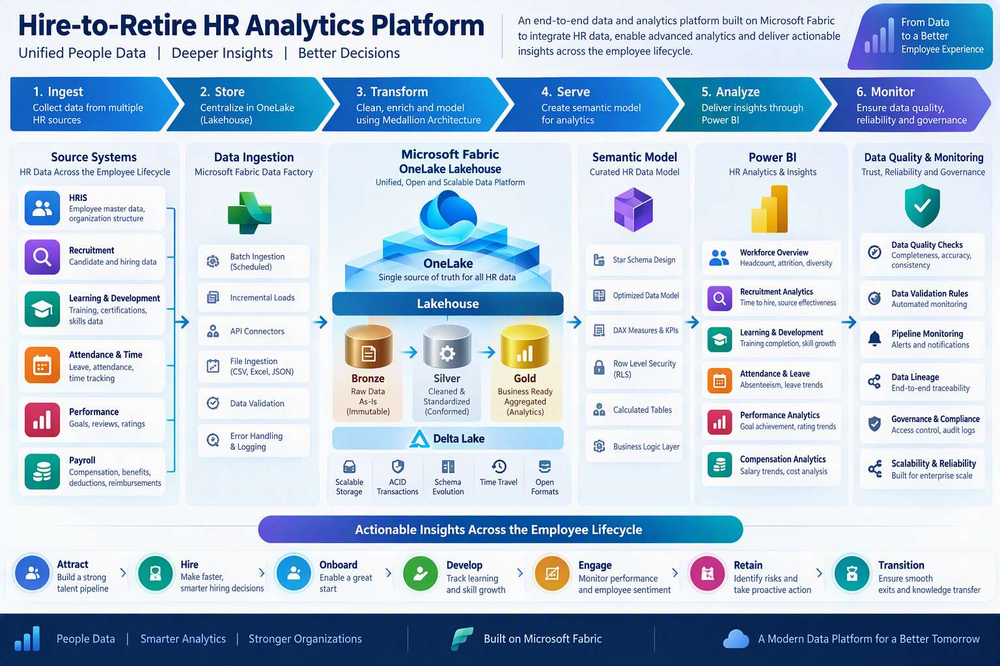
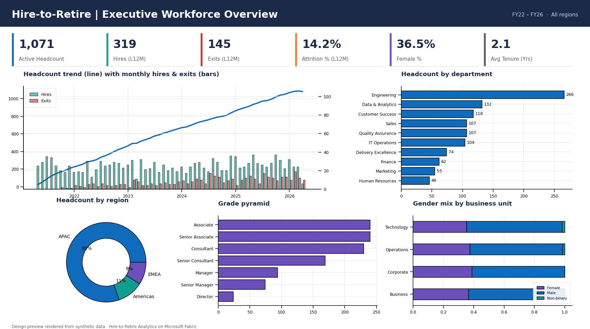
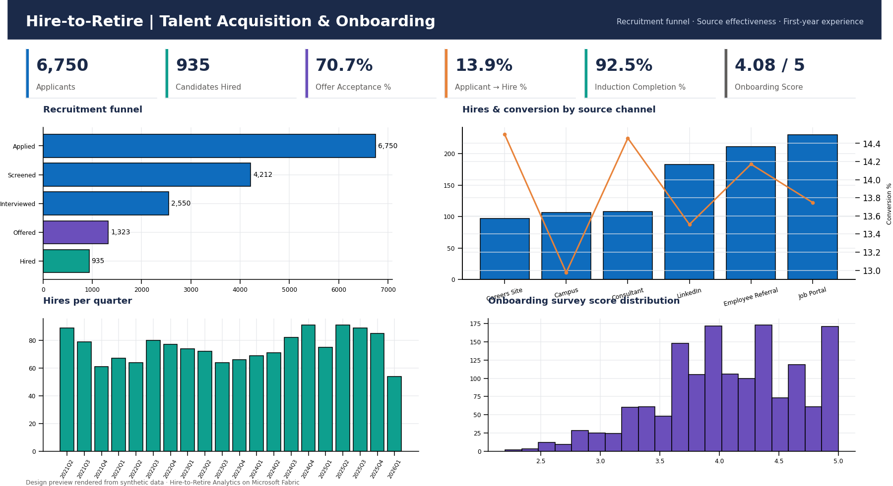
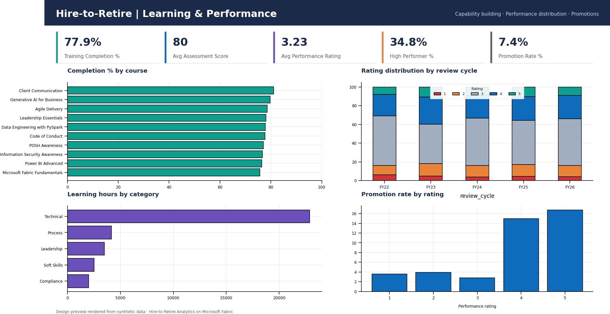
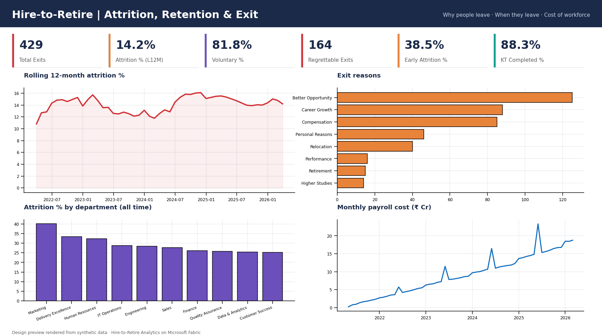

# 🏢 Hire-to-Retire (H2R) Workforce Analytics Platform on Microsoft Fabric

> End-to-end data engineering and analytics solution covering the complete employee lifecycle –
> **Attract → Hire → Onboard → Develop → Perform → Pay → Retain → Exit** – built on Microsoft Fabric
> using Lakehouse, Medallion Architecture, PySpark, Delta Lake, SQL and Power BI.


---

## 📌 Business Problem
HR data typically lives in disconnected systems – HRIS, recruitment (ATS), learning (LMS), time & attendance,
performance and payroll. Leaders cannot answer simple cross-lifecycle questions such as:

- *Which hiring sources produce employees who stay and perform?*
- *Is early attrition linked to onboarding experience?*
- *Are we losing our high performers – and why?*
- *What is the true cost of our workforce by business unit?*

## 💡 Solution
A unified **Hire-to-Retire analytics platform** on Microsoft Fabric that ingests six HR source systems into
OneLake, refines them through **Bronze → Silver → Gold** layers, enforces data-quality rules, and serves a
**Direct Lake semantic model** powering a 5-page Power BI report.

## 🏗️ Architecture


| Layer | Fabric item | What it does |
|---|---|---|
| Ingest | Data Factory pipeline `pl_h2r_daily_load` | Lands source files into `Files/raw/h2r`, orchestrates notebooks, alerts on failure |
| Bronze | Notebook `01_bronze_ingestion` | Raw, immutable Delta tables + audit columns + ingestion log |
| Silver | Notebook `02_silver_transformation` | Type casting, standardisation, de-duplication, derived attributes, quarantine |
| Gold | Notebook `03_gold_dimensional_model` | Star schema: 6 dimensions, 8 facts incl. monthly headcount snapshot |
| Quality | Notebook `04_data_quality_checks` | 18+ completeness, uniqueness, validity, referential & reconciliation checks |
| Serve | SQL analytics endpoint + Semantic model | Reporting views, 40+ DAX measures, RLS by department |
| Analyse | Power BI report | Executive, Talent Acquisition, Learning & Performance, Attrition & Exit, Data Health |

## 📊 Dashboard 

-Access Link - https://ameyvinchurkar.github.io/H2R-Unified-fabric-analytics-platform/powerbi/h2r-dashboard.html

| Executive Overview | Talent Acquisition & Onboarding |
|---|---|
|  |  |
| **Learning & Performance** | **Attrition, Retention & Exit** |
|  |  |

## 🔄 Employee Lifecycle KPIs
| Stage | Key metrics |
|---|---|
| Hire | Applicants, Offer Acceptance %, Applicant-to-Hire %, Time to Hire, Time to Fill, Source effectiveness |
| Onboard | Induction Completion %, Onboarding Score, Early Attrition % (exits < 1 yr) |
| Develop | Training Completion %, Learning Hours / Employee, Assessment Score |
| Perform | Avg Rating, High Performer %, Promotion Rate % |
| Pay | Total Gross Pay, Cost per Employee, Bonus % of Pay |
| Engage | Leave Days / Employee, Unplanned Leave % |
| Retain / Exit | Headcount, Attrition % (rolling 12M), Voluntary %, Regrettable Exits, Exit Reasons, KT Completion % |

## ⭐ Star Schema (Gold)
```
                 dim_date
                    │
dim_department ─┐   │   ┌─ dim_location
dim_grade ──────┼── dim_employee ──── dim_course
                │       │
   fact_headcount_monthly · fact_recruitment · fact_onboarding · fact_training
   fact_leave · fact_performance · fact_payroll · fact_exit
```

## 🧪 Data Engineering Highlights
- **Medallion architecture** with Delta Lake on OneLake
- **Parameterised notebooks** driven by Data Factory (full / incremental load mode, batch id)
- **Data quality by design** – synthetic data intentionally contains duplicates, inconsistent gender codes and lower-case keys, which Silver fixes
- **Quarantine pattern** – bad records are isolated, never silently dropped
- **Bronze ↔ Silver reconciliation** and pipeline **fail-fast** on critical DQ failures
- **Monthly headcount snapshot fact** for accurate attrition maths
- **Ops tables** (`ops_ingestion_audit`, `ops_dq_results`) feeding a Data Health report page

## 📁 Repository Structure
```
h2r-fabric-analytics-platform/
├── architecture/      Architecture diagram
├── data-generator/    Synthetic H2R data generator + dashboard preview renderer
├── sample-data/       13 synthetic source files (~65K rows)
├── notebooks/         Fabric PySpark notebooks (Bronze, Silver, Gold, DQ)
├── sql/               Reporting views, KPI queries, DQ queries (T-SQL)
├── powerbi/           DAX measures + report screenshots
└── docs/              Implementation guide, pipeline, data dictionary, report design
```

## 🚀 Run It Yourself
Follow **[docs/implementation-guide.md](docs/implementation-guide.md)** – a click-by-click guide to deploy this in a Fabric trial workspace.

```bash
cd data-generator
pip install -r requirements.txt
python generate_h2r_data.py --employees 1500 --out ../sample-data
```

## 🔐 Data Disclaimer
All data in this repository is **100% synthetic**, generated by `data-generator/generate_h2r_data.py`.
No real employee, candidate or organisational data is used.

## 👤 Author
**Amey Vinchurkar** – Senior Data & BI Consultant | Data Engineer | Microsoft Fabric (DP-700, DP-600) | Power BI (PL-300)
[LinkedIn](https://www.linkedin.com/in/ameyvinchurkar/) · [GitHub](https://github.com/AmeyVinchurkar)
